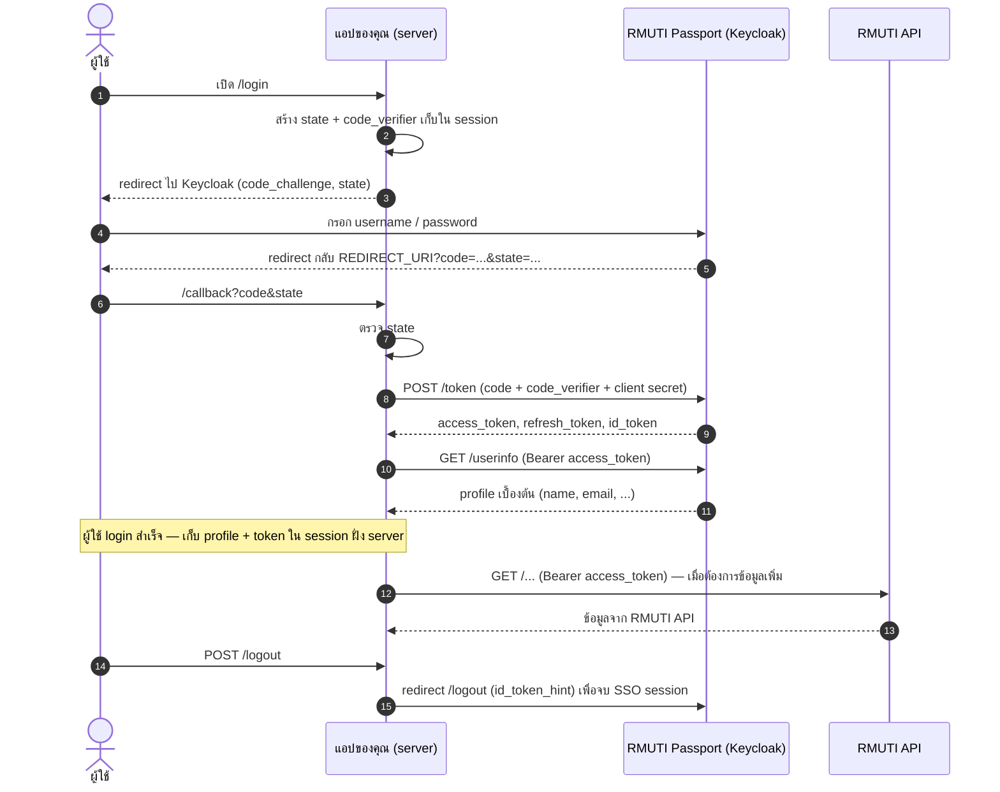

# RMUTI Passport – API Examples

ตัวอย่างโค้ดสำหรับนักพัฒนา**ระบบภายในมหาวิทยาลัยเทคโนโลยีราชมงคลอีสาน (RMUTI)**

1. ให้ผู้ใช้ **Login ผ่าน RMUTI Passport** (Keycloak / OpenID Connect) และได้ **profile เบื้องต้น**
2. นำ **access token** ไปเรียก **RMUTI API** เพื่อขอข้อมูลเพิ่มเติม

> **English summary:** Reference implementations of the OpenID Connect *Authorization Code flow (with PKCE)* against RMUTI Passport (Keycloak) in Node.js, Python, PHP and Next.js, plus how to call RMUTI APIs with the resulting access token. Intended for internal RMUTI developers.

## สารบัญ

- [RMUTI Passport – API Examples](#rmuti-passport--api-examples)
  - [สารบัญ](#สารบัญ)
  - [ภาพรวมการทำงาน](#ภาพรวมการทำงาน)
  - [สิ่งที่ต้องเตรียม](#สิ่งที่ต้องเตรียม)
  - [ตัวอย่างที่มี](#ตัวอย่างที่มี)
    - [Node.js (Express)](#nodejs-express)
    - [Python (Flask)](#python-flask)
    - [PHP](#php)
    - [Next.js (NextAuth)](#nextjs-nextauth)
  - [การตั้งค่า (Environment Variables)](#การตั้งค่า-environment-variables)
  - [Profile ที่ได้จาก Login](#profile-ที่ได้จาก-login)
  - [การเรียก RMUTI API ด้วย token](#การเรียก-rmuti-api-ด้วย-token)
  - [ข้อควรระวังด้านความปลอดภัย](#ข้อควรระวังด้านความปลอดภัย)
  - [แก้ปัญหาที่พบบ่อย](#แก้ปัญหาที่พบบ่อย)
  - [ขอบเขตของ repository นี้](#ขอบเขตของ-repository-นี้)
  - [การมีส่วนร่วมและติดต่อ](#การมีส่วนร่วมและติดต่อ)

## ภาพรวมการทำงาน

ทุกตัวอย่างใช้ flow เดียวกัน คือ **Authorization Code Flow + PKCE (S256) + `state`** แบบ confidential client (มี client secret ฝั่ง server)



## สิ่งที่ต้องเตรียม

ขอข้อมูลต่อไปนี้จากผู้ดูแลระบบ RMUTI Passport (Keycloak) ของหน่วยงานคุณ

| รายการ | คำอธิบาย |
|---|---|
| `KEYCLOAK_ISSUER` | URL ของ realm รูปแบบ `https://<sso-host>/realms/<realm>` |
| `KEYCLOAK_CLIENT_ID` / `KEYCLOAK_CLIENT_SECRET` | client ชนิด **confidential** ที่เปิด *Standard flow* |
| Valid redirect URIs | ต้องลงทะเบียน URL ของ `/callback` ทุกสภาพแวดล้อม (dev / staging / production) |
| Valid post logout redirect URIs | ต้องลงทะเบียน URL ที่จะกลับมาหลัง logout |
| URL ของ RMUTI API | endpoint ที่จะเรียกด้วย token และ scope/สิทธิ์ที่ต้องใช้ |

> ค่า `sso.example.com` และ `api.example.com` ในไฟล์ตัวอย่างเป็นเพียง placeholder ต้องแทนด้วยค่าจริง

## ตัวอย่างที่มี

| โฟลเดอร์ | เทคโนโลยี | พอร์ตเริ่มต้น | Redirect URI ที่ต้องลงทะเบียน |
|---|---|---|---|
| [`examples/nodejs-express`](examples/nodejs-express) | Node.js 20+ / Express | 3000 | `http://localhost:3000/callback` |
| [`examples/python-flask`](examples/python-flask) | Python 3.10+ / Flask | 5000 | `http://localhost:5000/callback` |
| [`examples/php`](examples/php) | PHP 8.1+ (ext-curl) | 8000 | `http://localhost:8000/callback.php` |
| [`examples/nextjs-nextauth`](examples/nextjs-nextauth) | Next.js (App Router) / NextAuth v4 | 3000 | `http://localhost:3000/api/auth/callback/keycloak` |

ทุกตัวอย่างมีหน้าเว็บ 3 ส่วนเหมือนกัน: **Login → แสดง profile → ปุ่มเรียก RMUTI API → Logout**

### Node.js (Express)

```bash
cd examples/nodejs-express
cp .env.example .env      # แล้วแก้ค่าใน .env
npm install
npm start
```

### Python (Flask)

```bash
cd examples/python-flask
cp .env.example .env      # แล้วแก้ค่าใน .env
python -m venv .venv && source .venv/bin/activate   # Windows: .venv\Scripts\activate
pip install -r requirements.txt
flask --app app run -p 5000
```

### PHP

```bash
cd examples/php
cp .env.example .env      # แล้วแก้ค่าใน .env
php -S localhost:8000 -t public
```

โค้ดที่ผู้ใช้เข้าถึงได้อยู่ใน `public/` เท่านั้น ส่วน `lib.php` และ `.env` อยู่นอก web root โดยตั้งใจ — **ตอน deploy ให้ชี้ document root ไปที่ `public/` เสมอ** มิฉะนั้นไฟล์ `.env` (มี client secret) จะถูกดาวน์โหลดได้

### Next.js (NextAuth)

```bash
cd examples/nextjs-nextauth
cp .env.example .env.local   # แล้วแก้ค่าใน .env.local
npm install
npm run dev
```

> ตัวอย่าง Node.js และ Next.js ใช้พอร์ต 3000 เหมือนกัน หากรันพร้อมกันให้เปลี่ยนพอร์ตและ Redirect URI

## การตั้งค่า (Environment Variables)

| ตัวแปร | บังคับ | คำอธิบาย |
|---|:-:|---|
| `KEYCLOAK_ISSUER` | ✅ | URL ของ realm |
| `KEYCLOAK_CLIENT_ID` | ✅ | Client ID |
| `KEYCLOAK_CLIENT_SECRET` | ✅ | Client secret — **ห้าม commit** และห้ามส่งไปฝั่ง browser |
| `REDIRECT_URI` | – | URL ของ `/callback` (ต้องตรงกับที่ลงทะเบียนใน Keycloak ทุกตัวอักษร) |
| `POST_LOGOUT_REDIRECT_URI` | – | URL ที่กลับมาหลัง logout |
| `SESSION_SECRET` | ✅ (Node, Flask) | ค่าสุ่มยาวอย่างน้อย 32 ตัวอักษร เช่น `openssl rand -base64 32` |
| `NEXTAUTH_URL`, `NEXTAUTH_SECRET` | ✅ (Next.js) | URL ของแอป และค่าสุ่มสำหรับเข้ารหัส session |
| `PROFILE_API_URL` | – | endpoint ของ RMUTI API ที่ใช้เดโมการเรียกด้วย token (ถ้าไม่ตั้ง ปุ่มเรียก API จะไม่แสดง) |

## Profile ที่ได้จาก Login

หลัง login สำเร็จ แอปจะได้ **profile เบื้องต้นจาก Keycloak** ผ่าน `userinfo` endpoint ทันที โดยไม่ต้องเรียก RMUTI API เพิ่ม (scope ที่ขอคือ `openid profile email`)

ฟิลด์ที่ได้ขึ้นกับ client scope และ mapper ที่ผู้ดูแล Keycloak ตั้งไว้ให้ client ของคุณ — ให้ดูจากผลลัพธ์จริงที่หน้า "Login Success" ของตัวอย่าง อย่าเดาชื่อฟิลด์เอง

ถ้าต้องการข้อมูลที่ไม่มีใน profile (เช่น ข้อมูลสังกัด/ตำแหน่ง/การศึกษา) ให้เรียก RMUTI API เพิ่มตามหัวข้อถัดไป

## การเรียก RMUTI API ด้วย token

แนบ access token ในทุก request:

```http
GET /v1/... HTTP/1.1
Host: api.example.com
Authorization: Bearer <access_token>
```

ข้อควรรู้:

- **access token อายุสั้น** (ปกติราว 5 นาที ขึ้นกับการตั้งค่าของ realm) ตัวอย่างทั้ง 4 แบบจึงมีโค้ด **refresh** ด้วย refresh token ก่อนเรียก API เมื่อ token ใกล้หมดอายุ ถ้า refresh ไม่สำเร็จ (หมดอายุ/ถูกเพิกถอน) แอปจะพาผู้ใช้ login ใหม่
- เก็บ token ไว้**ฝั่ง server** (session) เท่านั้น ไม่ส่งให้ JavaScript ฝั่ง browser — ตัวอย่าง Next.js จึงเรียก API ผ่าน route handler (`/api/rmuti-api`)
- API จะตอบ `401` ถ้า token หมดอายุหรือไม่ถูกต้อง และ `403` ถ้าผู้ใช้/client ไม่มีสิทธิ์ใช้ endpoint นั้น

## ข้อควรระวังด้านความปลอดภัย

โค้ดตัวอย่างทำสิ่งเหล่านี้ไว้ให้แล้ว ถ้านำไปดัดแปลงอย่าตัดออก:

- ใช้ `state` (กัน CSRF ตอน login) และ **PKCE S256** (กันการดักจับ authorization code)
- สร้าง session id ใหม่หลัง login (กัน session fixation) และตั้ง cookie เป็น `HttpOnly` + `SameSite=Lax`
- escape ข้อมูล profile ก่อนแสดงบนหน้าเว็บ (กัน XSS)
- logout ด้วยเมธอด `POST` และจบ SSO session ที่ Keycloak ด้วย `id_token_hint`
- ไม่ log ข้อมูลส่วนบุคคลหรือ token

สิ่งที่ต้องทำเองเมื่อขึ้นระบบจริง:

- ใช้ **HTTPS** เสมอ และตั้ง `NODE_ENV=production` (Node.js) / `APP_ENV=production` (Flask) เพื่อให้ cookie เป็น `Secure` (ถ้าอยู่หลัง reverse proxy ให้ตั้ง `trust proxy` / `ProxyFix` ตามเอกสารของ framework)
- เปลี่ยน session store จากตัวอย่าง (memory / ไฟล์) เป็น Redis หรือฐานข้อมูล
- เก็บ `KEYCLOAK_CLIENT_SECRET` และ `SESSION_SECRET` ใน secret manager / environment ของระบบ ไม่ใช่ในโค้ด
- โค้ดตัวอย่าง**ไม่ตรวจลายเซ็นของ id_token เอง** เพราะระบุตัวตนจาก `userinfo` ที่ดึงตรงจาก Keycloak ผ่าน TLS ด้วย token ที่เพิ่งแลกมา (ตามที่ OIDC อนุญาต) หากต้องใช้ id_token ในการตัดสินใจเรื่องสิทธิ์ ให้ตรวจลายเซ็น/`iss`/`aud`/`exp` ด้วยไลบรารี OIDC
- หาก API ของคุณ**รับ token จากผู้อื่น** (เป็น resource server) ต้องตรวจ token ฝั่งนั้นเอง ซึ่งอยู่นอกขอบเขตของ repo นี้

## แก้ปัญหาที่พบบ่อย

| อาการ | สาเหตุที่พบบ่อย |
|---|---|
| Keycloak แสดง `Invalid parameter: redirect_uri` | `REDIRECT_URI` ไม่ตรงกับ *Valid redirect URIs* ของ client (ตรวจ http/https, พอร์ต, `/` ท้าย URL) |
| `invalid_client` / `Invalid client credentials` | `CLIENT_ID` / `CLIENT_SECRET` ผิด หรือ client ไม่ได้เป็นชนิด confidential |
| `invalid_grant` ตอนแลก code | code ใช้ซ้ำ/หมดอายุ, `REDIRECT_URI` ไม่ตรงกับตอนขอ code, หรือ session ที่เก็บ `code_verifier` หาย (cookie ถูกบล็อก) |
| `Invalid login state` | เปิด `/callback` ตรง ๆ, session หมดอายุระหว่าง login, หรือ cookie ไม่ถูกส่ง (เช่นโดเมน/พอร์ตไม่ตรงกัน) |
| Logout แล้วขึ้น `Invalid redirect uri` | `POST_LOGOUT_REDIRECT_URI` ยังไม่ถูกเพิ่มใน *Valid post logout redirect URIs* |
| RMUTI API ตอบ `401` | access token หมดอายุ / ไม่ได้ส่ง header `Authorization: Bearer` |
| RMUTI API ตอบ `403` | client หรือผู้ใช้ไม่มีสิทธิ์ใช้ endpoint นั้น — ติดต่อ [ระบบแจ้งซ่อมด้านเทคโนโลยีสารสนเทศ](https://mis.rmuti.ac.th/oneservice) หรือ [อีเมล](mailto:mis@rmuti.ac.th) |

## ขอบเขตของ repository นี้

- ครอบคลุมเฉพาะการ login ของ**ผู้ใช้** (Authorization Code Flow) และการนำ token ไปเรียก API
- ไม่รวม flow แบบ machine-to-machine (`client_credentials`) และ Resource Owner Password Grant (ส่ง username/password ผ่านแอปโดยตรง) ซึ่งไม่แนะนำและไม่ใช้กับการ login ของผู้ใช้ — หากหน่วยงานของคุณมี service ที่ต้องเรียก API โดยไม่มีผู้ใช้ ให้ติดต่อผู้ดูแลเพื่อขอ client แบบ service account
- ตัวอย่างเหล่านี้ตั้งใจให้เล็กและอ่านง่ายเพื่อใช้เป็นแนวทาง ไม่ใช่ไลบรารีสำเร็จรูป

## การมีส่วนร่วมและติดต่อ

พบปัญหาหรือมีข้อเสนอแนะ เปิด Issue หรือ Pull Request ได้ที่ repository นี้ ขั้นตอนการ contribute ของ organization ดูได้ที่ [RMUTI-Dev/.github](https://github.com/RMUTI-Dev/.github)

สำหรับการขอ client / สิทธิ์เข้าใช้ RMUTI Passport และ RMUTI API ให้ติดต่อ [ระบบแจ้งซ่อมด้านเทคโนโลยีสารสนเทศ](https://mis.rmuti.ac.th/oneservice) หรือ [อีเมล](mailto:mis@rmuti.ac.th)
